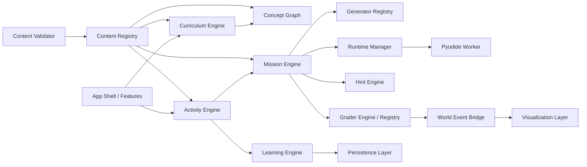
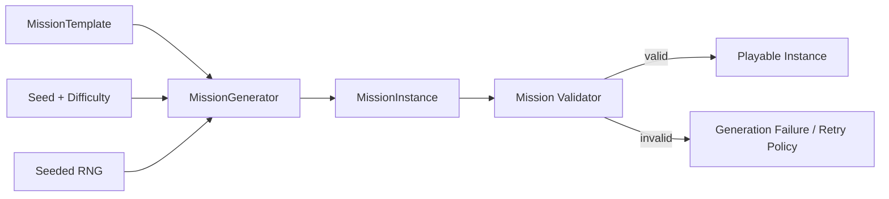
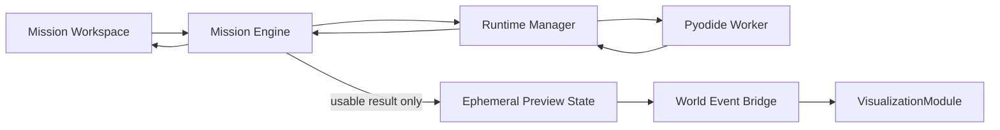
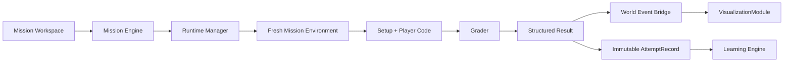

# Technical Architecture — Extensible Learning Game

## 1. Architectural Goal

The architecture must let CS116 ship as the first content package while keeping the learning engine reusable for later Python, Data Science, Machine Learning, PyTorch, Computer Vision, NLP, and Kaggle content.

The primary separation is:

```text
ENGINE
CONTENT
VISUALIZATION
```

The Core Engine owns generic learning behavior. Content defines what is learned and how activities are configured. Visualization translates semantic outcomes into visible reactions.

### Extensibility acceptance rule

> Adding a normal mission should not require modification of the Core Engine.

Target:

```text
80–90% new missions
→ content/config only

10–20% specialized missions
→ may add a generator/grader/visualization plugin
```

Similarly:

> Adding a normal lesson should primarily involve registering concepts, activities, missions, and progression—not modifying runtime, React routing, mastery logic, or Phaser core.

These are architectural acceptance tests, not a requirement to build a general-purpose plugin marketplace.

## 2. Planned Technology Stack

Current proposed stack:

```text
Vite
TypeScript
React
Monaco Editor
Pyodide in Web Worker
Phaser for 2D game-world visualization
IndexedDB for local persistence
```

Initial project does not need:

- backend;
- accounts;
- cloud saves.

The stack is an implementation direction. Generic engine interfaces should avoid exposing Pyodide, Phaser, or IndexedDB details to content definitions.

### 2.1 Module Dependency Direction Rules

Dependency direction is an architecture lock:

```text
core/
  MUST NOT import from content/
  MUST NOT import from features/
  MUST NOT import from visualization/

content/
  may depend on public core contracts/interfaces
  MUST NOT depend on React feature internals
  MUST NOT directly manipulate renderer internals

visualization/
  may depend on renderer-neutral WorldEvent / visualization contracts
  MUST NOT depend on curriculum/mastery/mission content internals

features/
  consume/compose public engine services
  should not own reusable domain rules

app/
  is the composition root
```

Generic Core Engine code must never import `content/cs116`. Built-in content-pack registration happens at the application/composition boundary.

Conceptual startup order:

```text
app bootstrap
→ initialize core services
→ register built-in CS116 content pack
→ validate registry
→ start application
```

This is a dependency rule only; no bootstrap implementation is part of Phase 0.

## 3. System Overview



Content packages register data and extension implementations into registries. Feature/UI code consumes stable engine services. Content does not reach through those services into framework internals.

## 4. Logical Systems and Responsibilities

### 4.1 App Shell

Owns:

- application bootstrapping;
- top-level navigation/layout;
- feature composition;
- loading/error boundaries;
- service initialization order.

Does not own:

- curriculum rules;
- concept mastery;
- mission generation;
- grading logic.

### 4.2 Curriculum Engine

Owns generic course presentation and progression queries:

- courses;
- worlds;
- lessons;
- activities attached to lessons;
- unlock/progression rules.

It consumes registered content definitions.

It must not encode CS116-specific topic names in generic engine logic.

### 4.3 Concept Graph

Owns knowledge dependency relationships between `Concept` nodes.

`Concept` is the smallest tracked learning unit.

Concept definition shape:

```text
id
title
description
classification
source
prerequisites
tags
```

Presentation hierarchy:

```text
Course → World → Lesson → LearningActivity
```

Knowledge dependencies:

```text
Concept Graph
```

These two structures are intentionally separate. A concept may appear in multiple lessons, reviews, transfer missions, or future courses without duplicating its dependency identity.

Concept IDs are persistence contracts. Once released, renaming requires an explicit data/content migration strategy.

### 4.4 Learning Engine

Owns:

- `AttemptRecord` ingestion;
- mastery derivation;
- review-priority calculation;
- recovery-session selection;
- learning-stage evidence queries.

Canonical `MasteryState` values:

```text
UNSEEN
DISCOVERED
PRACTICING
INDEPENDENT
TRANSFERRED
RETAINED
```

Mastery is derived from attempt history rather than stored as an unquestionable percentage.

The first review algorithm may be a simple heuristic and must be replaceable without changing content.

### 4.5 Activity Engine

Owns the lifecycle of generic `LearningActivity` definitions.

It selects and launches activity handlers according to activity type.

Architecture should allow:

```text
CODE_MISSION
DEBUG_MISSION
PREDICT_OUTPUT
EXPLAIN_SHAPE
RECALL_CODE
BOSS_MISSION
```

Only the subset needed by the vertical slice should be implemented first.

The Activity Engine keeps Exam Mode and non-code activities possible without forcing every activity through Python execution.

### 4.6 Mission Engine

Owns executable mission orchestration:

- resolves a `MissionTemplate`;
- asks the selected `MissionGenerator` for an instance;
- creates/loads a `MissionInstance`;
- coordinates Run and Submit lifecycles;
- passes code to `RuntimeManager`;
- passes execution results to the `Grader`;
- converts accepted semantic results into `WorldEvent` output;
- returns structured mission results to the Activity Engine.

It does not contain NumPy-specific exercise logic.

### 4.7 Generator Registry

Maps stable generator IDs to `MissionGenerator` implementations.

Each generator receives:

- template version/config;
- difficulty;
- seeded RNG;
- relevant generic generation context.

Generators must not call `Math.random()` directly.

The registry allows specialized generators without putting their logic into the Mission Engine.

### 4.8 Grader Engine / Grader Registry

The Grader Engine evaluates declarative grader configuration using reusable primitives.

Planned primitives:

```text
variable_exists
python_type
ndarray_type
dtype
shape
exact_values
approx_values
scalar_value
no_exception
raises_exception
not_mutated
```

The Grader Registry also supports registered custom graders for specialized missions.

All graders return a common structured result capable of expressing:

```text
pass/fail
check results
runtime errors
type errors
shape errors
value errors
conceptual guidance metadata
semantic result payload
```

UI copy may be rendered from this structure. Graders should not depend on React components.

### 4.9 Hint Engine

Owns progressive hint policy:

```text
H1 — Concept
H2 — Strategy
H3 — Relevant API / syntax
H4 — Pseudocode
```

Responsibilities:

- resolve hints for the activity/mission;
- enforce progressive unlock order;
- apply activity or Exam Mode restrictions;
- report hint use as learning evidence.

### 4.10 Runtime Manager

The UI and Mission Engine communicate with `RuntimeManager`, not directly with Pyodide.

Responsibilities:

- initialize runtime workers;
- execute Run requests;
- execute clean-state Submit requests;
- apply execution timeout;
- capture stdout/stderr/exceptions;
- terminate a stuck worker;
- replace/reinitialize workers;
- restore the mission environment;
- normalize runtime responses.

This boundary leaves room for a different future runtime without implementing one now.

### 4.11 Python/Pyodide Runtime

Initial runtime:

```text
Pyodide
inside a Web Worker
```

Pyodide-specific code stays behind the Runtime Manager/worker adapter.

The main thread must not execute learner Python in a way that allows an infinite loop to freeze the application.

### 4.12 World Event Bridge

Converts mission semantics into framework-neutral `WorldEvent` messages.

Example:

```text
TARGETS_SELECTED
{
  ids: ["r2", "r5"]
}
```

Content and mission code must not directly call Phaser scene/entity methods.

The bridge can route events to active `VisualizationModule` instances.

### 4.13 Visualization Layer

Visualization is defined above any specific renderer.

A `VisualizationModule` consumes semantic state/events and renders an appropriate representation.

Possible renderer families:

- Phaser: scene, entities, animation, spatial/game-world state, visual reactions;
- React/web: DataFrame/table, histogram, confusion matrix, feature chart, statistics panel.

Phaser must not manage:

- curriculum;
- concept mastery;
- mission generation;
- grading;
- review scheduling;
- learning progression.

The first Phaser setting is a small reusable **Sensor Control Room** with potential modules:

```text
SensorGrid
RadarTargets
StatusPanel
```

### 4.14 Persistence Layer

Initial persistence uses IndexedDB behind a repository/service boundary.

Persisted domains should include:

- learner settings;
- attempt history;
- derived/current progress snapshots when useful;
- content/version metadata needed to interpret old attempts.

Persistence code should not know React component state.

Attempt history is the durable evidence. Derived mastery can be recomputed or migrated from that evidence.

### 4.15 Content Registry

The Content Registry is the runtime catalog of validated content.

At startup the architecture should conceptually:

```text
load manifests
→ validate packs
→ register concepts
→ register courses/worlds/lessons
→ register activities
→ register mission templates
→ register generators
→ register graders
→ validate references
```

Invalid development content should fail loudly.

### 4.16 Content Validator

Validates static content and cross-references.

Planned checks:

```text
unique IDs
valid concept references
valid lesson/activity references
valid prerequisites
concept dependency cycles
generator existence
grader existence
visualization existence
hint references
runtime references
content/schema versions
```

Generated-content validation additionally checks produced instances over selected/fuzzed seeds.

## 5. Canonical Domain Terms

Use these names consistently:

```text
Concept
LearningActivity
MissionTemplate
MissionInstance
MissionGenerator
Grader
AttemptRecord
MasteryState
ContentPack
WorldEvent
VisualizationModule
```

Avoid synonyms in schemas when one of these canonical terms applies.

## 6. Content Pack Boundary

CS116 is the first `ContentPack`.

Future packs may include:

```text
cs116
numpy-extra
kaggle-practice
pytorch-foundation
computer-vision
```

A pack manifest should conceptually support:

```text
id
version
schemaVersion
title
description
courses
dependencies
```

Packs may contribute:

- concepts;
- course/world/lesson definitions;
- learning activities;
- mission templates;
- generators;
- graders;
- hints;
- visualization configuration/assets.

Do not implement remote pack installation, marketplaces, plugin sandboxing, or cloud content repositories for the first product.

## 7. Mission Data Contracts

### MissionTemplate

The template family should support references for:

```text
id
version
concept IDs
allowed learning stages
generator ID
generator configuration
grader ID
grader configuration
starter code
runtime configuration
hint set
visualization configuration
restrictions
```

### MissionInstance

Generated instance data may include:

```text
instance ID
template ID
template version
seed
difficulty
concept IDs
objective
context/story text
setup data
starter code
visible tests
grader data
world state
```

The exact TypeScript schemas are intentionally deferred to **Foundation 1 — Domain Types + Schemas**.

## 8. Deterministic Generation Contract

Invariant:

```text
same template
+
same version
+
same config
+
same difficulty
+
same seed
=
same mission
```

The engine supplies a common seeded RNG abstraction.

Generated mission flow:



Generator-specific retry policy must remain deterministic. For example, attempts can derive deterministic sub-seeds from the original seed and attempt index.

## 9. Run and Submit Data Flow

### Run



Run can return stdout, exceptions, and previews. When runtime output can be safely interpreted, the Mission Engine may produce ephemeral preview state or semantic `WorldEvent` messages so the visualization can show what the current code does.

Run does not:

- complete the mission;
- run final hidden grading;
- update mastery.

Run preview is non-authoritative. It may display valid-but-wrong learner output when pedagogically useful; for example, the radar may show targets selected by a structurally valid but incorrect boolean mask.

### Submit



Submit cannot depend on variables mutated by an earlier Run.

Each Submit produces exactly one immutable `AttemptRecord`, whether the submission passes or fails. The structured result is authoritative for that submission. Semantic `WorldEvent` output may represent the learner's actual valid result even when the grader marks it wrong, allowing visualization and feedback to explain the mismatch together.

## 10. Worker Protocol Concept

Do not expose Pyodide directly to React features.

The worker protocol should eventually use explicit request/response messages with IDs.

Conceptual request types:

```text
RUNTIME_INIT
MISSION_PREPARE
RUN_CODE
SUBMIT_CODE
INTERRUPT / TERMINATE handled by manager
```

Conceptual response types:

```text
READY
RUN_RESULT
SUBMIT_EXECUTION_RESULT
RUNTIME_ERROR
PROGRESS/LOAD status when useful
```

Responses should normalize:

- request ID;
- status;
- stdout/stderr;
- serialized result values required for grading;
- exception information;
- timing metadata when useful.

### Infinite-loop recovery

```text
execution timeout
→ terminate worker
→ create worker
→ reload Pyodide/runtime packages
→ restore MissionInstance setup
```

The UI remains responsive throughout recovery.

Do not over-design cooperative cancellation before proving that worker termination/recreation satisfies the vertical slice.

## 11. WorldEvent Contract

`WorldEvent` describes meaning, not rendering commands.

Example:

```text
TARGETS_SELECTED
payload:
  ids: [...]
```

Other future examples might include:

```text
SENSOR_GRID_LOADED
DATA_POINTS_REMOVED
FEATURES_STANDARDIZED
SCORES_UPDATED
MODEL_PREDICTIONS_READY
```

Event names should be stable enough for content/visualization contracts but introduced only when a real use case exists.

Bad coupling:

```text
mission → radar.lockTargets()
```

Required coupling:

```text
mission result → WorldEvent → VisualizationModule
```

## 12. Visualization Boundary

A visualization definition should reference:

- visualization/module ID;
- renderer type;
- initial semantic state mapping;
- subscribed `WorldEvent` types;
- content-facing configuration.

Phaser module responsibilities:

- scene;
- entities;
- animation;
- spatial/game-world state;
- visual reactions.

React/web module responsibilities can include:

- tables;
- charts;
- statistics;
- confusion matrices;
- feature summaries.

Content may select/configure a module but must not manipulate renderer internals.

## 13. Persistence and Versioning

### AttemptRecord

Semantic rule:

> One Submit creates one immutable `AttemptRecord`.

The record captures one submission-time evidence snapshot. A mission session with multiple submits produces multiple records rather than mutating one record. Both failed and successful submissions are preserved.

A conceptual v1 record may include:

```text
activityId
missionTemplateId
missionTemplateVersion
seed
conceptIds
learningStage
startedAt / submittedAt as appropriate
passed
submissionIndex
runCountBeforeSubmit
hintsUsed
runtimeErrorCount
graderSummary
```

An optional session identifier may be added later if useful for grouping, but no separate session subsystem is required for the vertical slice. The exact TypeScript schema remains deferred to Foundation 1.

### Versioning rules

- `Concept.id` is stable after release.
- `MissionTemplate.version` changes when semantics/generation/grading changes in a way that affects reproducibility.
- `ContentPack.version` identifies pack releases.
- `schemaVersion` identifies data-contract compatibility.
- Old attempts retain template/version/seed references required for interpretation.

Migration code should be introduced only when the first schema actually needs migration.

## 14. Content Validation Strategy

Static validation:

1. schema shape;
2. unique IDs;
3. valid references;
4. valid prerequisites;
5. dependency-cycle detection;
6. registry extension IDs exist;
7. version fields are valid.

Generated mission validation:

```text
generate seed
→ validate instance
→ reference solve
→ run grader
→ ensure reference answer passes
```

For generators, test multiple seeds and edge conditions.

Expected future developer commands:

```text
npm run content:validate
npm run content:test
npm run content:fuzz
```

Responsibilities:

- `content:validate`: static schemas/references/graph;
- `content:test`: known templates, validators, reference solvers, graders;
- `content:fuzz`: many deterministic seeds through generation → validation → solve → grade.

These commands are documented only in this task and are not implemented yet.

## 15. Testing Strategy

Build tests around contracts that protect extensibility and learner correctness.

### Domain/schema tests

- valid definitions parse;
- invalid references are rejected;
- duplicate IDs are rejected;
- concept cycles are rejected.

### Determinism tests

- same inputs produce identical `MissionInstance`;
- changed seed produces an allowed variant.

### Generator tests

- invariants hold across representative seeds;
- edge cases remain solvable.

### Grader tests

- trusted/reference answer passes;
- representative wrong shape/type/value fails with correct category.

### Runtime tests

- normal code returns;
- exception returns without breaking app;
- timeout recovers worker;
- Submit starts clean.

### Integration tests

For the vertical slice, prove:

```text
content
→ generated mission
→ runtime
→ grader
→ WorldEvent
→ visualization reaction
→ AttemptRecord
→ mastery/review evidence
```

Do not create large end-to-end test suites before individual boundaries exist.

## 16. Proposed Source Structure

Documented target:

```text
src/
  app/

  core/
    curriculum/
    learning/
    activities/
    missions/
    generators/
    grading/
    hints/
    runtime/
    world-events/
    persistence/
    content/

  features/
    home/
    world-map/
    lesson/
    mission-workspace/
    free-practice/
    review/
    progress/
    settings/

  visualization/
    phaser/
    modules/

  content/
    cs116/
      concepts/
      worlds/
      lessons/
      activities/
      missions/
      generators/
      graders/
      assets/

  shared/

  dev/
    content-tools/
```

Do not create empty directories solely to resemble this tree. Foundation tasks will create only the paths required by actual implementation.

## 17. Content Authoring Workflow

Initial workflow:

```text
TypeScript/data definitions
→ schema validation
→ developer preview
→ automated content tests
```

Do not build a GUI content authoring tool yet.

After schemas stabilize and enough real content exists, a later phase may add:

```text
/dev/content
```

for mission generation/preview tooling.

## 18. Extension Points

### Normal mission

Should be content/config only:

- register template;
- select existing generator;
- configure generator;
- select/configure grader primitives;
- add hints;
- map semantic result to existing visualization behavior.

### Specialized mission

May register:

- custom `MissionGenerator`;
- custom `Grader`;
- new `VisualizationModule`.

The Mission Engine itself should remain unchanged unless the new requirement is generic across activities.

### New lesson

Should primarily register:

- concept references;
- `LearningActivity` definitions;
- mission templates;
- lesson ordering/unlocks.

It should not require runtime or React routing changes.

### Future course/content pack

Should reuse:

- Concept Graph;
- Learning Engine;
- Activity Engine;
- Mission Engine;
- grader infrastructure;
- hint system;
- review/recovery;
- persistence.

Renderer and runtime additions remain optional extension points.

## 19. Explicitly Deferred Systems

Do not require any of these before the NumPy vertical slice:

```text
remote content marketplace
plugin sandbox
cloud content repository
SQL runtime
JavaScript runtime
no-code authoring system
multiplayer
procedural large world
AI-generated public mission publishing
advanced spaced-repetition algorithm
generic AST restriction framework
performance grading framework
```

Add them only after concrete product evidence creates a requirement.

## 20. First Vertical Slice Architecture

The first slice uses:

```text
Concepts
  numpy.array
  numpy.shape
  numpy.ndim
  numpy.index.column
  numpy.compare
  numpy.boolean_mask
  numpy.logical_and
```

It should exercise a minimal but complete path:

```text
CS116 ContentPack
→ Content Registry
→ Concept/Activity definitions
→ MissionTemplate
→ seeded MissionGenerator
→ MissionInstance
→ RuntimeManager/Pyodide Worker
→ reusable Grader
→ structured result
→ WorldEvent
→ Sensor Control Room VisualizationModule
→ AttemptRecord
→ Learning Engine
→ IndexedDB
```

Do not expand the NumPy curriculum until this path is proven stable enough to author against.

## 21. Architecture Review Checklist

Before implementation phases are considered complete, verify:

- Engine contains no unnecessary CS116-specific logic.
- Concept Graph is independent of presentation hierarchy.
- `LearningActivity` is not restricted to executable code.
- `MissionTemplate` and `MissionInstance` remain separate.
- generators use supplied seeded RNG.
- normal grading uses reusable primitives.
- Run and Submit remain semantically separate.
- clean-state Submit is preserved.
- runtime worker can be replaced after timeout.
- content emits semantic `WorldEvent` data instead of Phaser commands.
- Phaser owns rendering/game-world state only.
- Core Engine code never imports `content/cs116`; app bootstrap performs built-in content registration.
- future content packs can register into the same learning architecture.
- no deferred future system is required to reach the NumPy vertical slice.

